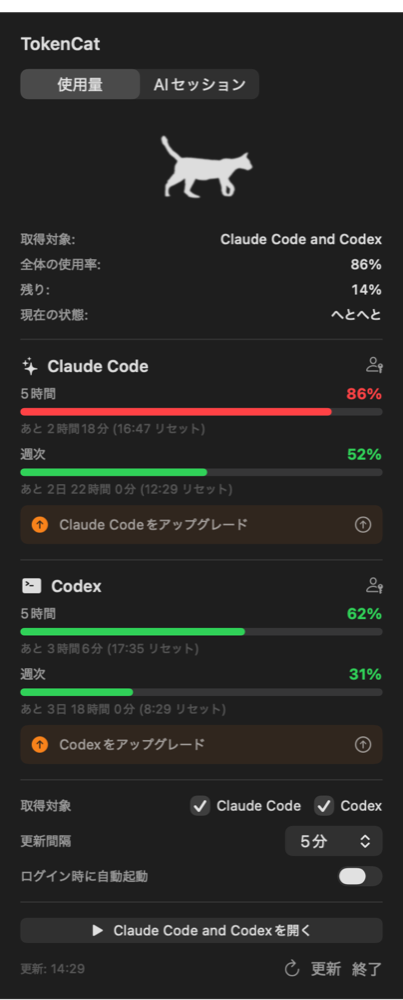
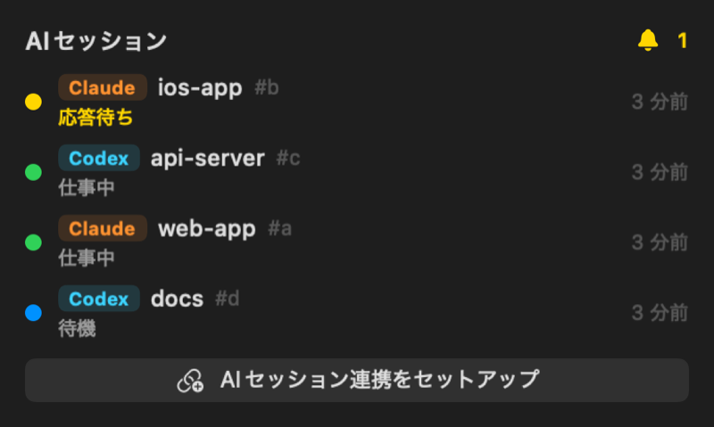

# TokenCat

**Claude Code / Codex の残量を、メニューバーの猫で。**

TokenCat は macOS のメニューバーに住む猫です。Claude Code と Codex の使用量（5時間枠・週次枠）に合わせて、猫が走り、歩き、やがて力尽きて立ち止まります。数字を読まなくても、残りの余力がひと目でわかります。

猫は、写真家エドワード・マイブリッジが1887年に撮影した本物の猫の連続写真から切り抜いたシルエットです。メニューバーではシステムアイコンと同じく、ライト／ダークに合わせて黒・白が自動で切り替わります。

## ダウンロード

**[最新版をダウンロード (Releases)](https://github.com/karaageeeee/TokenCat-app/releases/latest)**

1. `TokenCat-<version>.dmg` を開き、`TokenCat.app` を「アプリケーション」へドラッグします。
2. TokenCat を起動すると、メニューバーに猫が現れます。

- 無料です。
- 動作環境: macOS 14 (Sonoma) 以降、Apple Silicon (M1 以降) の Mac。
- Apple の公証 (Notarization) 済みなので、そのまま開けます。
- Claude Code または Codex CLI に、あらかじめログインしておいてください。
- Claude Code のログイン情報は約8時間で期限が切れ、ターミナルで `claude` を起動したときに更新されます。デスクトップアプリだけを使っている場合は、ときどきターミナルで `claude` を一度起動してください。

## できること

| 使用量をひと目で | 並列で動かすAIを采配 |
| --- | --- |
|  |  |

- **残量で猫の様子が変わる**: 全力で走る → 小走り → 歩く → ゆっくり歩く → 力尽きて立ち止まる
- **Claude Code と Codex を同時に表示**: 5時間枠・週次枠の使用率と、リセットまでの残り時間
- **AIセッションの采配ビュー**: 複数の Claude Code / Codex セッションが「仕事中・応答待ち・待機」のどれかを一覧表示。応答待ちのAIをすぐ見つけられ、作業が終わると通知します
- 状態が変わったときの macOS 通知、更新間隔の設定、ログイン時の自動起動
- 日本語 / 英語

### AIセッション連携のセットアップ

ポップオーバーの「AIセッション」タブで「AIセッション連携をセットアップ」を押すと、Claude Code (`~/.claude/settings.json`) と Codex (`~/.codex/hooks.json`) にフックが追加されます。既存の設定は残したまま、TokenCat 用の項目だけを追記します。

## プライバシーとセキュリティ

TokenCat は外部に独自のサーバーを持たず、データを収集しません。

- **Claude Code の使用量**: Claude Code が macOS キーチェーンに保存しているログイン情報を読み取り、Anthropic の使用量API (`api.anthropic.com`) にだけ HTTPS で問い合わせます。初回起動時にキーチェーンへのアクセス許可を求められることがあります。
- **Codex の使用量**: インストール済みの `codex` コマンド (`codex app-server`) から取得します。
- **AIセッション連携**: フックからの通知は `127.0.0.1`（自分のMac内）だけで受け取ります。通知には `~/.tokencat/token` に保存したランダムな合言葉が必要で、このファイルは本人だけが読めます。
- 公開前に、ローカル通信部分を中心としたセキュリティレビューを実施しています。

脆弱性を見つけた場合は、公開の Issue ではなく GitHub の [Security Advisory](https://github.com/karaageeeee/TokenCat-app/security/advisories/new) からご連絡ください。

## 不具合・要望

[Issues](https://github.com/karaageeeee/TokenCat-app/issues) へどうぞ。

## クレジット

猫のシルエットは、パブリックドメインの写真から作成しています。

- Eadweard Muybridge, *Animal Locomotion* (1887), Plates 716 / 718 / 720（USC Digital Library、Boston Public Library のスキャン、Wikimedia Commons 経由）
- お座りの姿勢: USDA の写真（Wikimedia Commons 経由、パブリックドメイン）

---

TokenCat は個人開発のアプリで、Anthropic および OpenAI とは関係ありません。Claude は Anthropic の、Codex は OpenAI の商標です。
